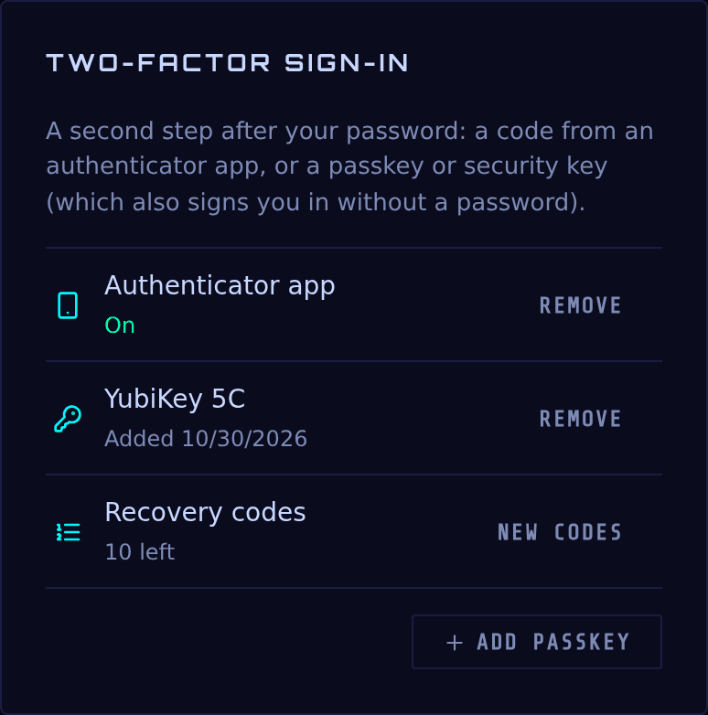
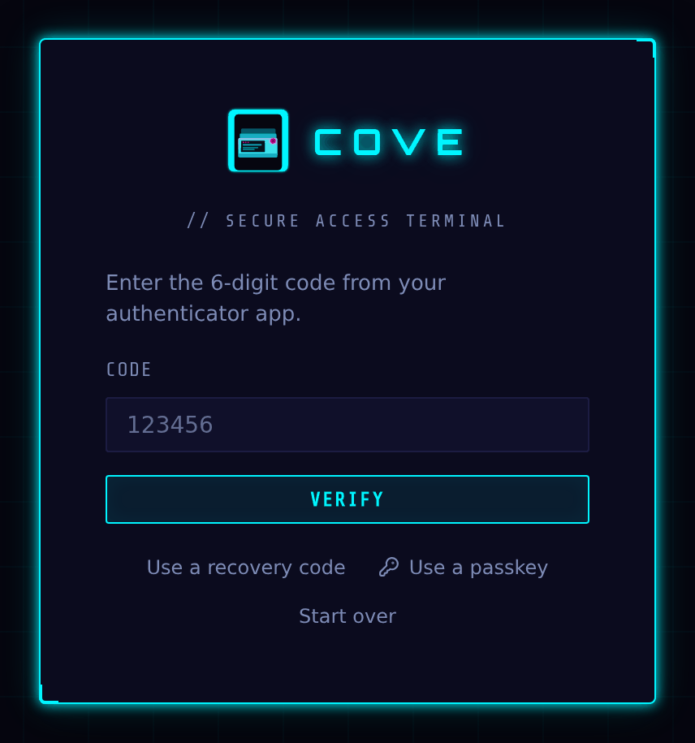
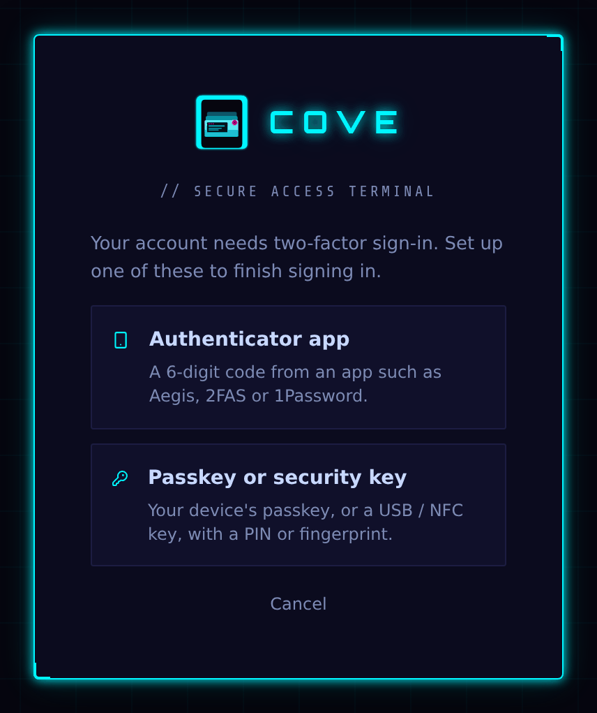
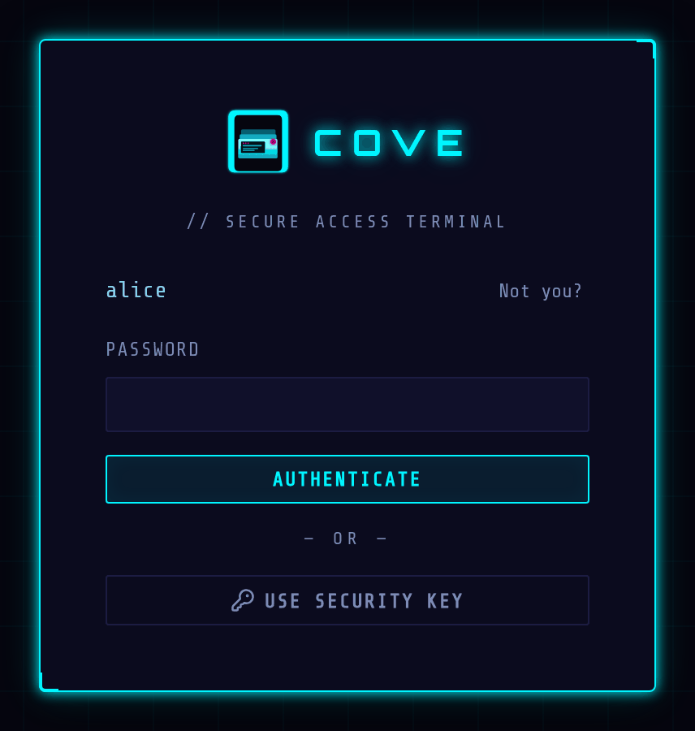
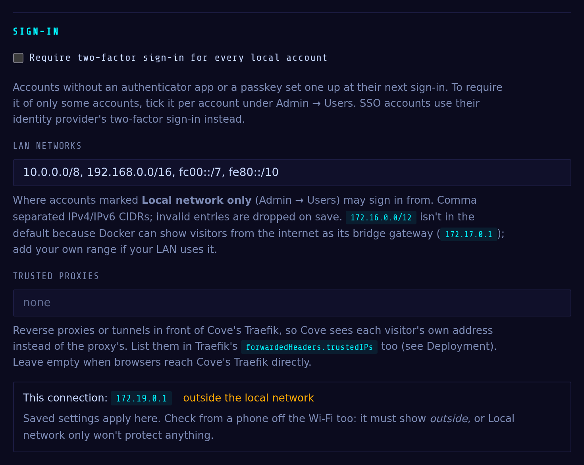

# Authentication

Cove supports **local accounts** (username + password) and **OIDC/SSO**
against any standards-compliant provider, which can run together or SSO-only.

## First-run setup

On a brand-new install with no users, visiting Cove shows the **first-run setup**
screen. It creates a single account with **admin** rights:

- Username — 1–64 characters of `[a-zA-Z0-9._-]` (not `.` or `..`).
- Password — at least **8 characters**.

Setup is only available while zero users exist; afterward the endpoint is closed.
It is also disabled entirely in [OIDC-only mode](#oidc-only-mode).

## Local accounts

- **Login** is username + password. Passwords are hashed with **bcrypt** (per-hash random salt).
- **Rate limiting:** the application allows `COVE_LOGIN_RATE_LIMIT` attempts (default **10**) per `COVE_LOGIN_RATE_WINDOW_SECONDS` (default **60 s**) per client IP; Traefik adds an independent edge limit (~5/min, burst 10) on the login route. Excess attempts return `429`.
- Login timing is constant whether or not the username exists, to avoid leaking which accounts are registered.

Admins create and manage additional accounts under **Admin → Users** — see
[Administration → User management](administration.md#user-management).

## Sessions & tokens

Cove issues signed (HS256) JSON Web Tokens delivered as **httpOnly cookies**:

| Cookie | Contains | Default lifetime | Scope |
|---|---|---|---|
| `cove_session` | access token | 30 min (`COVE_ACCESS_TOKEN_MINUTES`) | path `/` |
| `cove_refresh` | refresh token | 7 days (`COVE_REFRESH_TOKEN_DAYS`) | path `/api/auth` |
| `cove_stream` | per-workspace stream token (subdomain mode) | 480 min (`COVE_STREAM_TOKEN_MINUTES`) | the workspace origin only |

- Cookies are **host-only** (no `Domain`) so the powerful session cookie is never sent to workspace origins. They carry `Secure` when `COVE_COOKIE_SECURE=true` — required over HTTPS, and the reason the cookie silently fails if you serve HTTPS with it set `false`.
- The API also accepts an `Authorization: Bearer <token>` header as an alternative to the cookie.
- **Refresh:** the SPA silently rotates the session via the refresh cookie. **Logout** revokes all of a user's outstanding tokens (it stamps a `tokens_valid_from` marker) and clears the cookies. Changing your password does the same, ending other sessions.

## Two-factor sign-in

Local accounts can add a second step to signing in (SSO accounts use their
identity provider's instead). In **Preferences → Two-factor sign-in**:

- **Authenticator app**: scan the QR code with an app such as Aegis, 2FAS or
  1Password and confirm a code. Signing in then asks for the 6-digit code after
  the password.
- **Passkey or security key**: your device's passkey (Windows Hello, Touch ID,
  a phone) or a USB / NFC key such as a YubiKey. Cove always asks the key for
  its PIN or fingerprint, so a passkey on its own is two factors: **Sign in
  with a passkey** needs only your username, with no password and no code.
  After a password, a passkey also works as the second step.
- **Recovery codes**: ten one-time codes, shown once when you add your first
  second factor. Each signs you in once if you lose your phone or key. Make a
  new set (the old ones stop working) from the same panel.





Adding, removing or renewing anything here asks for your password. Your first
second factor also signs you out everywhere else: those sessions began with the
password alone. This browser stays signed in. Wrong codes are limited: five per sign-in (then it
starts over with the password) and ten per account in 15 minutes. A code
can't be used twice.

**Passkeys need Cove's domain name.** Cove offers passkeys only when
`COVE_APP_ORIGIN` is set to its public address by name (for example
`https://cove.example.com`; `docker-compose.prod.yml` sets it). Every passkey is
made for that name and works only there, whatever address a request arrives
on, so a look-alike site in front of Cove can't collect them. WebAuthn doesn't
work by IP address at all; on such installs only the authenticator app is
offered.

### Requiring it

An admin can require two-factor sign-in for one account (**Admin → Users →
Edit → Require two-factor sign-in**) or every local account (**Admin →
Settings → Sign-in**). An account without a second factor then sets one up as
part of its next sign-in, before it gets a session, and can't remove its last
one. Sessions that already exist aren't ended; they're asked at their next
sign-in (use **Sign out** on the user to end them now).



Lost phone or key? **Admin → Users → Reset 2FA** removes the account's
authenticator app, passkeys and recovery codes and signs it out everywhere.
The user signs in with their password next (and sets up a new factor, if
it's required).

### On a thin client

A kiosk has no passkey store of its own, so it signs in with a **USB security
key**: it asks for the username, then the password or **Use security key**
(touch the key and enter its PIN). Debian's udev rules give the signed-in
kiosk user access to a plugged-in FIDO key; nothing else needs installing. A
code from an authenticator app is asked for only after a password, never after
a key. NFC isn't supported (Chromium on Linux doesn't read NFC keys).



Register the key once from any browser (Preferences → Two-factor sign-in →
Add passkey), or from the kiosk itself.

## Local network only accounts

Tick **Local network only** on an account (Admin → Users) and it works only
from your own network: signing in (password or SSO), refreshing a session,
every API call and opening a workspace stream are all refused from anywhere
else, with *"This account can only be used from the local network."* A leaked
password, or a session cookie stolen from a laptop, is then useless from the
internet. A browser that leaves the network (a laptop taken out of the house)
is signed out on its next request. The message only appears after a correct
password, so it doesn't tell a guesser that the account exists.

What counts as the local network is set in **Admin → Settings → Sign-in**:

- **LAN networks**: default `10.0.0.0/8, 192.168.0.0/16, fc00::/7, fe80::/10`.
  `172.16.0.0/12` is left out because Docker can present visitors from the
  internet (IPv6 ones in particular) as its bridge gateway, `172.17.0.1`; add
  your own range if your LAN uses it.
- **Trusted proxies**: anything in front of Cove's Traefik (another reverse
  proxy, a tunnel). Cove skips their addresses to find each visitor's own. See
  [Deployment → Behind another reverse proxy](deployment.md#behind-another-reverse-proxy).



The page shows the address Cove sees for your own connection and whether it
counts as local. **Check it once from a phone off the Wi-Fi**: it must say
*outside the local network*. If it says local, every visitor looks local to
Cove (typically a tunnel or proxy that isn't listed) and the setting protects
nothing.

Cove errs towards refusing. A request is local only if its address is in the
LAN networks, isn't itself a trusted proxy (Cove can't see past it), and no
other address the request carries for its visitor (`X-Forwarded-For`,
`CF-Connecting-IP`, `True-Client-IP`, `Forwarded`) is outside them. Those
headers can't make a request look local; a client faking them only locks
itself out.

Cove won't let you lock yourself out: it refuses to turn the setting on for
your own account from outside the network, or to save network settings under
which your current connection would stop counting as local.

## OIDC / SSO

Cove speaks standard OpenID Connect (authorization-code flow) and is **not tied
to any one provider**. Everything beyond the issuer and client credentials —
endpoints, signing keys, whether to use PKCE, how to authenticate at the token
endpoint — is read from the issuer's discovery document at startup. Kanidm,
Authentik, Keycloak, Entra ID, Okta and Google all work from the same three
settings.

OIDC is **enabled only when all three** of `COVE_OIDC_ISSUER`,
`COVE_OIDC_CLIENT_ID`, and `COVE_OIDC_CLIENT_SECRET` are set. With OIDC on, a
"Sign in with `<provider>`" button appears (label = `COVE_OIDC_PROVIDER_NAME`);
local login still works as a fallback unless [OIDC-only](#oidc-only-mode) is on.

```ini
# .env
COVE_OIDC_ISSUER=https://idm.example.com/oauth2/openid/cove
COVE_OIDC_CLIENT_ID=cove
COVE_OIDC_CLIENT_SECRET=...
COVE_OIDC_PROVIDER_NAME=Kanidm           # button label
COVE_OIDC_ADMIN_GROUP=cove-admins        # group that grants admin (optional)
```

In your IdP, set the redirect URI to:

```
https://<your-domain>/api/auth/oidc/callback
```

`COVE_OIDC_ISSUER` must be exactly what the provider's discovery document
declares as `issuer` (a trailing slash either way is fine). If they disagree,
Cove refuses to load discovery and says so in the log rather than trusting
whichever value arrived over the network.

### Provider quick reference

| Provider | Issuer | Notes |
|---|---|---|
| **Kanidm** | `https://idm.example.com/oauth2/openid/<client>` | PKCE is mandatory (handled automatically). Client auth is HTTP Basic only. `preferred_username` is an SPN unless you run `kanidm system oauth2 prefer-short-username <client>` — Cove trims the `@realm` either way. |
| **Authentik** | `https://auth.example.com/application/o/<app>/` | Works with defaults. |
| **Keycloak** | `https://kc.example.com/realms/<realm>` | For realm roles instead of groups, set `COVE_OIDC_GROUPS_CLAIM=realm_access.roles`. Group names arrive path-prefixed (`/cove-admins`); Cove matches either spelling. |
| **Entra ID** | `https://login.microsoftonline.com/<tenant>/v2.0` | Groups come back as GUIDs unless the app is configured to emit names — set `COVE_OIDC_ADMIN_GROUP` to the GUID, or use `COVE_OIDC_GROUPS_CLAIM=roles`. |
| **Okta** | `https://<org>.okta.com/oauth2/<server>` | Add a groups claim to the ID token in the authorization server. |
| **Google** | `https://accounts.google.com` | No group claims at all — leave `COVE_OIDC_ADMIN_GROUP` unset and grant admin in **Admin → Users**. |

### Setting up a Kanidm client

```sh
kanidm system oauth2 create cove "Cove" https://cove.example.com
kanidm system oauth2 add-redirect-url cove https://cove.example.com/api/auth/oidc/callback
kanidm system oauth2 update-scope-map cove cove-users openid email profile groups
kanidm system oauth2 prefer-short-username cove          # optional
kanidm system oauth2 show-basic-secret cove              # -> COVE_OIDC_CLIENT_SECRET
```

Members of `cove-admins` become Cove admins once `COVE_OIDC_ADMIN_GROUP=cove-admins`
is set. Kanidm's `groups` scope returns both UUIDs and SPNs
(`cove-admins@idm.example.com`); Cove matches the plain name, so you don't need
`groups_name`.

**Provisioning & admin mapping**

- Users are matched by their OIDC subject. A new user's username is derived from the claims in `COVE_OIDC_USERNAME_CLAIMS` (default `preferred_username`, then `email`, then `sub`) — sanitized to the allowed charset, with a numeric suffix on collision. A `user@realm` value is trimmed to `user` unless `COVE_OIDC_USERNAME_STRIP_DOMAIN=false`.
- If `COVE_OIDC_ADMIN_GROUP` is set, admin status is taken from the group claim on **every** login (so removing someone from the group revokes their admin on next login). If it's unset, existing admin status is left untouched. Set several groups comma-separated; membership of any one grants admin.
- Group values are matched against bare names, SPNs (`name@realm`), Keycloak paths (`/name`) and object-shaped entries, case-insensitively — so `cove-admins` is the right thing to configure whatever shape your provider emits. Matching is whole-value, never a substring.
- The groups scope is only requested when an admin group is configured, so a provider that rejects unknown scopes won't fail login over data Cove has no use for.

### Advanced settings

These exist for providers whose discovery document under-reports what they
support. **Leave them at their defaults unless SSO is failing.**

| Variable | Default | Purpose |
|---|---|---|
| `COVE_OIDC_DISCOVERY_URL` | *(derived)* | Discovery elsewhere than `{issuer}/.well-known/openid-configuration`. |
| `COVE_OIDC_SCOPES` | `openid email profile` | Base scopes. `openid` is always included. |
| `COVE_OIDC_GROUPS_SCOPE` | `groups` | Scope requesting group membership (Kanidm also has `groups_name`, `groups_spn`). |
| `COVE_OIDC_GROUPS_CLAIM` | `groups` | Claim holding groups; dotted path for nested claims. |
| `COVE_OIDC_USERNAME_CLAIMS` | `preferred_username,email,sub` | Claims tried in order for the username. |
| `COVE_OIDC_USERNAME_STRIP_DOMAIN` | `true` | Trim `user@realm` to `user`. |
| `COVE_OIDC_PKCE` | `auto` | `auto` follows discovery; `true` forces it for providers that support PKCE without advertising it. |
| `COVE_OIDC_TOKEN_AUTH_METHOD` | `auto` | `auto` prefers HTTP Basic (the OIDC default); or pin `client_secret_basic` / `client_secret_post`. |
| `COVE_OIDC_USE_USERINFO` | `true` | Merge userinfo claims in, for providers that put groups only there. |
| `COVE_OIDC_METADATA_TTL_SECONDS` | `3600` | Discovery + JWKS cache lifetime; bounds how long signing-key rotation takes to apply. |

**Security hardening (for reference):** the ID token's signature is verified
against the issuer's JWKS with the algorithm pinned to an asymmetric allowlist
(RS/ES/PS), so `HS256`/`none` are never honored; audience, issuer, and a one-time
`nonce` are all checked; the `state` parameter is HMAC-signed; PKCE (S256) is
used whenever the provider supports it, with the verifier held in an httpOnly
cookie. Userinfo claims are merged *underneath* the verified ID-token claims and
only when the subject matches, so a bearer-fetched claim can never override a
cryptographically verified one.


## OIDC-only mode

Set `COVE_OIDC_ONLY=true` to remove local login and local account creation
entirely — the SPA goes straight to the IdP, and `setup`/`login`/admin
user-creation are blocked.

This mode is **gated on OIDC being fully configured** (`oidc_only_active = oidc_only AND oidc_enabled`). That's a safety net: if the OIDC config is broken or
incomplete, OIDC is considered disabled, so OIDC-only does **not** activate and
the local login form remains available. You cannot lock everyone out with a
half-finished config.

**To recover or disable SSO-only:** set `COVE_OIDC_ONLY=false` (or fix/remove the
OIDC settings) on the server and restart. The local login form returns.

## Per-user credentials

Each user manages their own secrets under **Preferences** — password (local
accounts only), SSH key, Tailscale, and Gluetun. See
[User guide → Preferences](user-guide.md#preferences).
