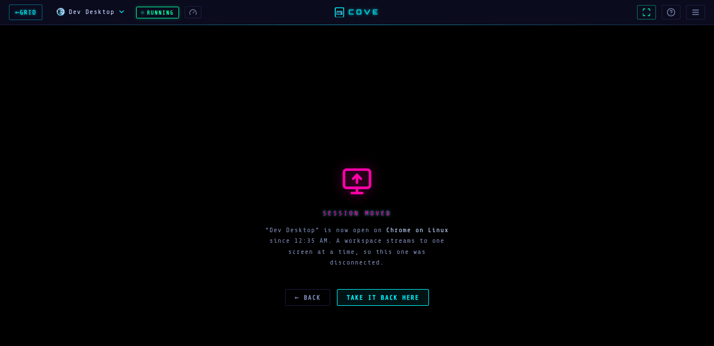

# User guide

This is the day-to-day guide to using Cove as a regular user. For the full set of
launch options and the workspace lifecycle, see [Workspaces](workspaces.md).

## Navigation

After signing in you're in the SPA under `/app`. The top navigation has:

- **Dashboard** — your workspaces, plus the launch buttons.
- **Files** — browse your workspace storage.
- **Preferences** — password, SSH key, Tailscale, Gluetun.
- **Admin** (admins only) — Users, Sessions, Images, Audit, Settings. See [Administration](administration.md).
- **Background tasks** (the checklist icon) — app installs, updates and removals
  running inside your workspaces. It shows a spinner and a count while work is in
  flight; open it for progress and each task's log. See [Managing apps](#managing-apps-in-a-workspace).

## The dashboard

The dashboard ("Workspaces") lists **your own** workspaces in up to three
sections: **Needs attention** (workspaces that crashed or failed to start, with
the reason), **Active** (running or changing state) and **Stopped** (most
recently used first). It refreshes on its own every few seconds — faster while
something is starting or stopping, and paused while the tab is in the
background — so a workspace that stops by itself (a crash, the admin's
max-runtime limit, a stop from another device) shows up without a reload.
A strip above the grid totals the CPU and memory of everything running.

Each card shows:

- The **status**: Starting / Running / Stopping / Migrating / Stopped / Error.
  While starting it also says what it's waiting on — **downloading the image**
  (with a progress bar; the first start of an image downloads several GB),
  installing packages, or waiting for the desktop to draw.
- A row of **settings chips**: network (Direct / VPN / Tailscale), Persistent or
  Ephemeral, and LAN, sudo, Docker and GPU when enabled.
- **Time**: "Up 2 h" while running, "Last used 3 d ago" when stopped. If the
  admin set a maximum runtime, a running card counts down to the automatic stop;
  in the last hour it turns amber and offers **Extend** (restarts the clock).
- A live **CPU** and **memory** readout for running containers, and for
  tailnet-routed workspaces the **Tailscale IP** (copyable).
- Actions: **Connect** or **Start**, and in the **Actions** menu **Edit**,
  **Apps**, **Logs** (also on a failed workspace), **Stop**, **Clone**,
  **Migrate** and **Delete**.

**Launch** at the top opens the one launcher for everything: it asks what you
want — a **Desktop**, a **Browser**, or an **App** — then shows only the images of
that kind.

## Screen previews

Every **running** card shows a still of what's actually on that workspace's screen, so
you can tell your workspaces apart at a glance without opening them.

- The frame is captured from the workspace's **own stream**, so it works the same
  for every image and needs nothing installed inside it.
- It doubles as the **readiness check**: you can't connect to a workspace until
  Cove has decoded a real frame from its stream (the card shows **STARTING** until
  then), so the stream never opens half-ready.
- Previews are **dropped the moment a workspace stops** — a stopped card never
  shows what was last on its screen. Starting it again takes a fresh one.
- A stream Cove can't read simply leaves the card with a placeholder. The
  workspace still launches normally.

Previews are served only to you (or an admin). See
[Workspaces → Screen previews](workspaces.md#screen-previews) for the details.

## Launching a desktop

1. Click **Launch** and choose **Desktop**.
2. Pick an **image** (e.g. a Webtop XFCE/KDE/MATE variant, or Kali) and give it a **name**.
3. Optionally expand the extra options (apps, networking, sudo, SSH) — see [Workspaces → Launch options](workspaces.md#launch-options).
4. Click **Launch**. Cove creates the container and takes you to the workspace view, which shows a **Starting** screen (with download progress on the first start of an image) until the desktop is ready, then streams it into the page.

The first launch of an image pulls it from `lscr.io` and can take a few minutes; the wizard marks images that aren't downloaded yet.

## Opening a website (browser workspaces)

Browser images (Chromium, Brave, Firefox, Edge) can start straight at one or more
URLs — a lightweight way to deliver a web app:

1. Click **Launch** and choose **Browser**.
2. Pick the **browser** (Chromium, Brave, Firefox, Edge, Helium, Vivaldi or Opera).
3. Enter one URL per line — **up to 6**; each opens in its own tab. Multiple tabs open full-screen with a tab bar.
4. Options for a single URL, shown only where that browser supports them (see
   [Workspaces → browser start-up options](workspaces.md#browser-start-up-options)):
   - **Kiosk mode** — full-screen with no browser chrome.
   - **Allow right-click / refresh menu** — keeps a minimal menu instead of a hard kiosk lock.

   **Dark mode** sits on its own (it applies with or without kiosk) and starts
   **on when your own browser is in dark mode**, so an opened link doesn't flash
   white at you. Untick it to override.
5. Optionally tick **Ephemeral** (no saved data — cookies/history/downloads wiped when it stops) or **Route through Tailscale**.
6. Click **Launch**.

## In-stream controls

While viewing a running workspace, a top bar provides:

- **Quick-switch menu** — a dropdown next to the workspace name listing all your workspaces (running first). Jump between them, and **start a stopped one in place** without returning to the dashboard.
- **Fullscreen** (`FULL` / `WINDOW`) — expand the stream to fill the window.
- **CRT** — a retro scanline/flicker overlay (cosmetic; per-user toggle).
- **Apps** — on a desktop workspace, manage its proot-apps and AppImages (see [above](#managing-apps-in-a-workspace)).
- **Files** — browse the workspace's home folder, download files, make folders, and upload (pick files, or drop them onto the dialog). See [Moving files in and out](#moving-files-in-and-out).
- **Logs** — opens diagnostics: container logs and (for tailnet workspaces) `tailscale status`.
- **HALT** — stop and remove the container (persistent data is kept).
- **APP / install** — install *this* workspace as its own PWA (its own icon and window). Handy for a single-purpose browser workspace.
- **System info** — the gauge button next to the status badge. It carries a green lock when the workspace is routed through a VPN and a network icon for Tailscale (the tooltip names the profile and exit node), and opens one dialog with everything about the running workspace: uptime and auto-stop (with **Extend**), live CPU / memory / processes / network / disk I/O against its limits, the network route (VPN profile, provider and servers with the tunnel's health, or the tailnet IP, hostname, exit node and `tailscale status`), LAN access, the public IP it really exits from (**Check**, looked up from inside the workspace), home folder type and size, and container details (image, IDs, restarts, zone, options, hardening).

### One screen at a time

A workspace streams to one screen at a time. Opening it somewhere else (another
browser, another computer, a thin client) moves the stream there, and the page
that had it says so: **Session moved** names where it went ("Desk (thin
client)", "Firefox on Linux") and since when. **Take it back here** moves the
stream back, and the other screen then shows the same message. The workspace
keeps running throughout; only the screen showing it changes.

## Moving files in and out

- **Drop files onto the stream** to copy them into the workspace: they land in
  `~/Desktop` on a desktop and `~/Downloads` on a browser or app workspace, with
  a progress strip in the corner and a note saying where each one went. A name
  that already exists gets ` (2)` added rather than overwriting it. Folders are
  skipped (drop the files inside).
- **Menu → Files** browses the home folder (`/config`): click into folders,
  download a file (button or double-click), make a folder, or upload into the
  folder on screen with **Upload** or by dropping onto the list. Dotfiles are
  hidden until you press the eye button.

Files are written by the workspace's own user, so the desktop can open, edit and
delete them normally. Uploads follow the admin's upload size limit. On an
ephemeral workspace they are gone when it stops, like everything else in it.

> Dropping onto the stream: when workspaces are served on their own subdomains,
> the page can't see a drag that enters straight over the stream, so the drop
> target appears once the drag crosses the top bar or the page edge. Drag in
> from the top if nothing happens.

## Managing apps in a workspace

**Actions → Apps** on a running desktop (or **Apps** in the stream page's menu)
manages what's installed inside that workspace, without a terminal:

- **proot-apps** — the list shows each app with its icon and whether it's **up to
  date** or has an **update available**, compared against the LinuxServer
  registry. Update one, update all, install more from the catalog, or remove one.
- **AppImages** — the list shows each app's size and the URL it came from.
  Install more by pasting URLs, update one by pasting the URL to install over it,
  or remove it. There's no update check here: an AppImage URL carries no version
  to compare, so you choose the link.

Everything runs as a **background task** inside the workspace, one at a time. You
can close the dialog; the **tasks** icon in the top bar tracks progress across all
your workspaces and keeps each task's log. Installing or removing also updates the
workspace's saved app lists, so a reboot or a migration reinstalls what you
actually have.

Booting a workspace installs anything missing from those saved lists (it shows
in the tasks menu as a *saved apps* task) but never updates what's already
there — updates are always your call. If something is still missing, **Install
all** in the Apps dialog queues every saved app that isn't installed. For the details see
[Workspaces → Managing apps](workspaces.md#managing-apps-in-a-running-workspace).

## The file browser

**Files** lets you browse, upload, download, organize, and delete files within
**your own** storage area (`<storage>/<your-username>/…`, which holds your
workspaces' `/config` homes). Access is confined to your directory — path
traversal is rejected — and a single upload may be up to `COVE_MAX_UPLOAD_MB`
(default **1024 MiB**). It has two tabs: **Files** and **Trash**.

Each row has a **download** button and a **⋯** menu with everything else (Open,
Copy, Cut, Move to trash, Delete permanently). Right-clicking a row opens the
same menu at the cursor; the arrow keys, Enter and Esc work inside it.

### Getting files in

- **Upload** — pick one or more files; they land in the folder you're viewing.
- **Folder** — pick a whole folder; its sub-folders are recreated as the files upload.
- **Drag and drop** files or folders from your desktop onto the file list.

There is no separate "new folder" action — folders appear when you upload one.

### Moving and copying

Choose **Copy** or **Cut** from a row's **⋯** menu, navigate to the destination, then **Paste**
(the button appears in the header once something is on the clipboard). Or **drag a
row onto a folder** — or onto **root** in the breadcrumb — to move it there. A name
collision doesn't overwrite: the arriving item is given a suffix.

### Downloading

**Download** on a file sends the file. **Download** on a folder sends it as a
streamed **zip**, so there's no need to fetch a directory tree file by file.

### Trash

Deleting is a **soft delete** by default:

- **Move to trash** (in the row's ⋯ menu) moves the item into your trash and out of the
  listing. Nothing is destroyed.
- The **Trash** tab lists what's in there with each item's original location,
  size, when it was deleted, and when it **expires**.
- **Restore** puts an item back where it came from, recreating the folder if it's
  gone. If something with that name is already there, the restored copy is
  suffixed rather than overwriting it.
- **Delete permanently** in a trash row's ⋯ menu, or **Empty trash**, destroys the bytes immediately.
- **Delete permanently** on a normal row **skips the trash** entirely.
  Both ask for confirmation and can't be undone.

Trash expires on its own: the admin's **trash retention** setting (default **30
days**) decides how long an item is kept before Cove purges it automatically, and
the Trash tab shows the countdown per item. Set to `0`, nothing auto-expires and
the trash is kept until you empty it — see
[Administration → Settings](administration.md#settings).

## The browser extension

**Open in Cove** adds a right-click action to the browser on your own machine:
send any link to a fresh Cove browser workspace instead of opening it locally.
You pick the browser, the network route (direct, VPN or Tailscale) and the
start-up options, and the page loads in a container.

**It is for Chrome-based browsers** — Chrome, Edge, Brave, Vivaldi, Opera, Helium
and other Chromium forks. There is no Firefox build.

Download it from the **user menu → Browser extension** (click your account name,
top right). Your Cove server ships the zip, so this works with no internet
access. Then:

1. **Unzip it somewhere it can stay** — Chrome loads an unpacked extension from
   that folder every time it starts, so deleting the folder uninstalls it.
2. Open `chrome://extensions` (Edge `edge://extensions`, Brave
   `brave://extensions`, and so on).
3. Turn on **Developer mode**.
4. Click **Load unpacked** and pick the unzipped folder — the one holding
   `manifest.json`.
5. Open the extension's **options** and enter your Cove address.

To update later, unzip the new version over the same folder and press **Reload**
on the extension's card.

Each link opens in a brand-new workspace, so browsers that have a first-run
screen (Vivaldi's setup window, Opera's welcome tabs) show it on *every* launch —
they start from an empty profile each time. Chromium and Helium don't have one.
See [Troubleshooting](troubleshooting.md#a-browser-opens-its-own-welcome-screen-instead-of-the-link).

It signs in as you without a password, including for SSO accounts: it reads your
existing Cove session and presents it as a bearer token, so the identity provider
flow happens in a normal browser tab. Only an access token is ever stored.

## Preferences

Manage your own account and routing under **Preferences**:

- **Password** — change it (local accounts only; hidden for SSO accounts). Minimum 8 characters; changing it signs out your other sessions.
- **SSH key** — generate a fresh **Ed25519** keypair, or upload your own private key (ed25519/rsa/ecdsa/dsa; **unencrypted** keys only — passphrase-protected keys are rejected). The public key and fingerprint are shown; the private key is encrypted at rest and never returned. When set, it's injected into each workspace's `~/.ssh` at launch (toggle per workspace with **Inject SSH key**), so in-container `git`/`ssh` works out of the box.
- **Tailscale** — enable it and store your **auth key** (a preauth key, encrypted at rest) and an optional **login/control server** (e.g. a Headscale `https://` URL). Per-launch options (exit node, accept routes/DNS) are chosen when launching a workspace.
- **Gluetun (VPN)** — enable it, choose **OpenVPN** or **WireGuard**, and upload your VPN **config file** (encrypted at rest, up to 128 KiB). You can optionally override the WireGuard private key or OpenVPN username/password as separate secrets.

See [Networking & routing](networking.md) for how Tailscale and Gluetun apply to
a workspace's traffic.
